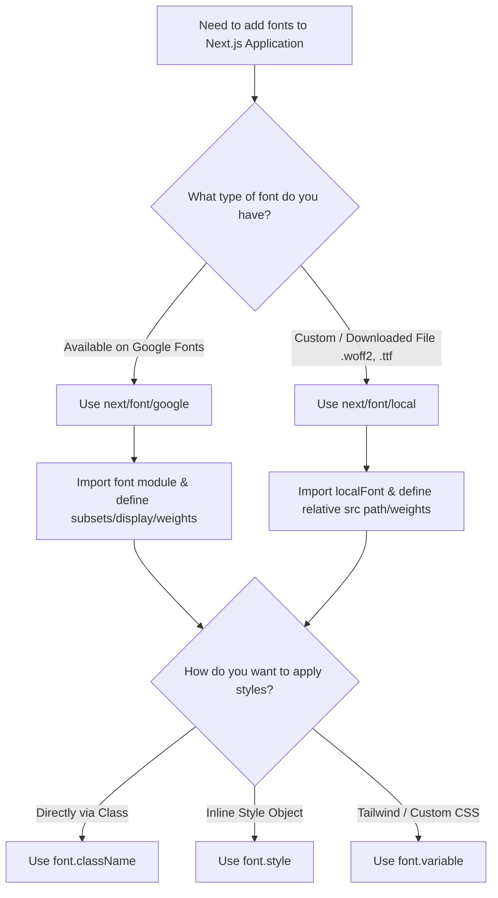
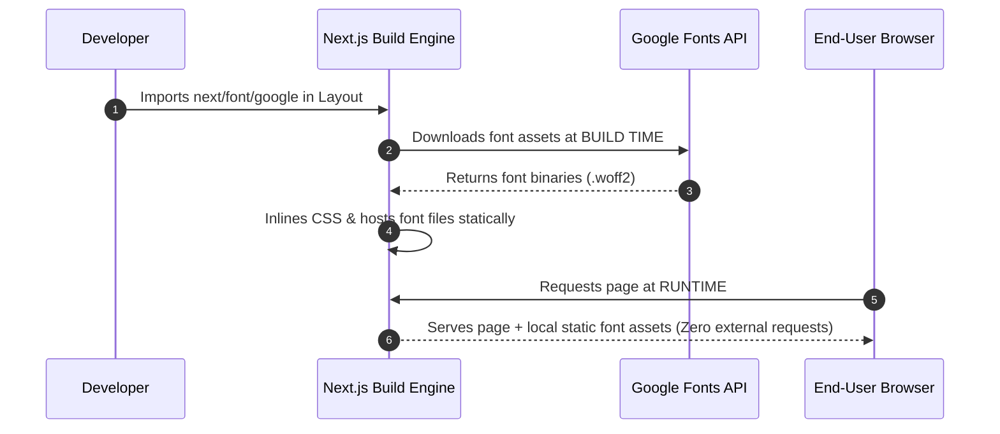

# Next.js Fonts: `next/font/google` and `next/font/local`



---

## 1. Why Does Next.js Provide `next/font`?

Normally, we can load fonts using CSS or external font services. However, this may introduce external network requests and cause layout shifts while fonts load.

Next.js provides the `next/font` APIs to optimize font loading and help reduce layout shifts.

There are two main options:
- `next/font/google` — Load fonts available through Google Fonts.
- `next/font/local` — Load font files stored inside your project.

Next.js processes fonts for your application so the browser can load the optimized font assets from your application rather than fetching the font directly from Google Fonts at runtime.

### Next.js Build-Time Optimization Process



---

## 2. Using `next/font/google`

Suppose we want to use the Inter font throughout our Next.js application.

**File:** `app/layout.js`
```javascript
import { Inter } from 'next/font/google';

const inter = Inter({
  subsets: ['latin'],
  display: 'swap',
});

export default function RootLayout({ children }) {
  return (
    <html lang="en">
      <body className={inter.className}>
        {children}
      </body>
    </html>
  );
}
```

### Understanding the code

| Property | Meaning |
| :--- | :--- |
| `Inter` | The Google Font we want to use |
| `subsets: ['latin']` | Specify the Latin subset to preload |
| `display: 'swap'` | Show fallback text while the font loads |
| `inter.className` | Apply the generated font class |

We can apply the font globally through the root layout or only to a particular element.

**Example:**
```jsx
<h1 className={inter.className}>
  Hello, Next.js!
</h1>
```

---

## 3. What Are Font Subsets?

A font subset is a collection of characters supported by a particular portion of a font.

Websites may display text in different writing systems, such as:
- **Latin** — English and other Latin-script languages
- **Cyrillic** — used by languages such as Russian
- **Greek** — used by Greek
- **Devanagari** — used by Hindi and several other languages

The available subsets depend on the particular font.

**Example:**
```javascript
import { Inter } from 'next/font/google';

const inter = Inter({
  subsets: ['latin'],
});
```
Here, `latin` identifies the Latin character subset.

### Why do we specify subsets?
Next.js can preload the font subset we specify. Preloading helps the browser discover important font resources earlier.

### Remember:
1. `subsets` is mainly relevant when configuring Google Fonts.
2. Use subset names supported by the selected font.
3. `subsets` does not create a new font subset.
4. If your website needs Hindi characters, check whether your chosen font supports Devanagari.

---

## 4. Using `next/font/local`

Suppose we downloaded a custom font file called `MyFont.woff2`.  
We can load it using `next/font/local`.

### Example project structure
```text
my-app/
└── app/
    ├── layout.js
    └── MyFont.woff2
```

**File:** `app/layout.js`
```javascript
import localFont from 'next/font/local';

const myFont = localFont({
  src: './MyFont.woff2',
  display: 'swap',
});

export default function RootLayout({ children }) {
  return (
    <html lang="en" className={myFont.className}>
      <body>{children}</body>
    </html>
  );
}
```

### Important points
- `localFont` is imported from `next/font/local`.
- `src` specifies the path to the font file.
- The path is relative to the file where the font is configured.
- Adjust the path if the font is stored in another folder.
- The `subsets` option is not normally needed for local fonts.

### When should we use local fonts?
Use `next/font/local` when:
- You have downloaded a `.woff2`, `.woff`, `.ttf`, or supported font file.
- A designer has supplied a custom font.
- You want to use a font that is not available through the Google Fonts API.

---

## 5. Using Multiple Font Weights

Sometimes, we have separate font files for regular, bold, and italic text.  
We can configure multiple font files together.

```javascript
import localFont from 'next/font/local';

const myFont = localFont({
  src: [
    {
      path: './fonts/Regular.woff2',
      weight: '400',
      style: 'normal',
    },
    {
      path: './fonts/Bold.woff2',
      weight: '700',
      style: 'normal',
    },
  ],
});
```

### Understanding the weights

| Weight | Meaning |
| :--- | :--- |
| **400** | Normal text |
| **500** | Medium text |
| **600** | Semibold text |
| **700** | Bold text |

The available weights depend on the font files you have.  
If the font is a variable font that supports a range of weights, you can often use one file instead of separate files.

---

## 6. Important `next/font` Options

These are the main options worth understanding.

| Option | Purpose |
| :--- | :--- |
| `src` | Path to a local font file |
| `subsets` | Specify Google Font subsets to preload |
| `weight` | Define supported font weights |
| `style` | Define font styles such as normal or italic |
| `display` | Control how text is displayed while the font loads |
| `preload` | Enable or disable font preloading |
| `fallback` | Specify fallback font families |
| `variable` | Expose the font through a CSS variable |

Some additional properties are available on the font object returned by the font function:

| Property | Purpose |
| :--- | :--- |
| `className` | Generated class for applying the font |
| `style` | Generated inline style object for applying the font |

> **Important:** The `style` configuration option and the returned `font.style` property are different things.

---

## 7. Understanding `display: 'swap'`

**Example:**
```javascript
const inter = Inter({
  subsets: ['latin'],
  display: 'swap',
});
```

When the custom font is not ready yet, the browser can display text using a fallback font. Once the custom font loads, the browser switches to it.

This helps prevent invisible text while waiting for the font.

---

## 8. Understanding `preload`

**Example:**
```javascript
const inter = Inter({
  subsets: ['latin'],
  preload: true,
});
```

`preload` controls whether Next.js preloads the font.

Preloading tells the browser to prioritize downloading an important font resource.

For a font used throughout the main layout, preloading may be helpful. For fonts that are not immediately needed, disabling preloading may be appropriate.

The default behavior is generally suitable for common use cases.

---

## 9. Understanding `fallback`

**Example:**
```javascript
const inter = Inter({
  subsets: ['latin'],
  fallback: ['Arial', 'sans-serif'],
});
```

The `fallback` option specifies alternative font families.

If the preferred font is not available at a particular moment, the browser can use an alternative font.

Conceptually, the font stack is:
```css
font-family: Inter, Arial, sans-serif;
```
The exact generated CSS is managed by Next.js.

---

## 10. Understanding `className`, `style`, and `variable`

These are three useful ways to apply a configured font.

### A. `className` — simplest approach
```jsx
<h1 className={inter.className}>
  Welcome to Next.js
</h1>
```
Use this when you want to apply the font directly to an element.  
For a global font, apply the class to the root layout's body or another appropriate root element.

### B. `style` — use the generated style object
```jsx
<h1 style={inter.style}>
  Welcome to Next.js
</h1>
```
The returned `inter.style` object contains the generated styles needed to apply the font.  
This is different from the `style` option used to configure normal or italic font files.

### C. `variable` — useful with CSS and Tailwind

**Example:**
```javascript
import { Inter } from 'next/font/google';

const inter = Inter({
  subsets: ['latin'],
  variable: '--font-inter',
});
```

Apply the generated variable class:
```javascript
export default function RootLayout({ children }) {
  return (
    <html lang="en">
      <body className={inter.variable}>
        {children}
      </body>
    </html>
  );
}
```

Then use the variable in CSS:
```css
h1 {
  font-family: var(--font-inter);
}
```

### Why use `variable`?
It gives you more control over where and how the font is used through CSS.  
It is particularly useful when:
- You want to define typography centrally.
- You use CSS variables.
- You want to integrate fonts with a styling system such as Tailwind CSS.

---

## 11. Google Fonts vs Local Fonts

| Feature | `next/font/google` | `next/font/local` |
| :--- | :--- | :--- |
| **Font source** | Google Fonts catalog | Your own font files |
| **Import** | `next/font/google` | `next/font/local` |
| **Requires `src`** | No | Yes |
| **`subsets`** | Useful for preloading | Not normally needed |
| **Font weights** | Depends on the selected font | Depends on the supplied files |
| **`className`** | Supported | Supported |
| **`variable`** | Supported | Supported |
| **Custom downloaded fonts** | Not the primary use case | Yes |

### Which one should I choose?
- Use `next/font/google` if you want a font from Google Fonts.
- Use `next/font/local` if you have a downloaded font file or a custom font provided by a designer.

---

## 12. Mini Quiz

### Q1. You downloaded a `.woff2` file. Which API should you use?
**Answer:** `next/font/local`  
*It loads a font file stored in your project.*

### Q2. What does `subsets: ['latin']` primarily tell Next.js?
**Answer:** Which font subset to preload.

### Q3. Which option exposes a font through a CSS variable?
**Answer:** `variable`  
*It lets you use the font through CSS, for example:*
```css
font-family: var(--font-inter);
```

---

## 13. Quick Revision

| Goal | Use |
| :--- | :--- |
| Load a Google Font | `next/font/google` |
| Load a downloaded font | `next/font/local` |
| Specify a character subset to preload | `subsets` |
| Show fallback text while loading | `display: 'swap'` |
| Control font preloading | `preload` |
| Specify fallback font families | `fallback` |
| Apply a font directly | `className` |
| Apply the generated font styles | `style` |
| Use a font through CSS variables | `variable` |
| Configure regular and bold font files | `weight` and `src` |

---

## Official Documentation
- [Next.js Font API](https://nextjs.org/docs/app/api-reference/components/font)
- [Next.js Google Fonts](https://nextjs.org/docs/app/building-your-application/optimizing/fonts#google-fonts)
- [Next.js Local Fonts Guide](https://nextjs.org/docs/app/building-your-application/optimizing/fonts#local-fonts)