# Next.js `next/image` — Complete Guide

A beginner-to-advanced guide covering how Next.js Image works internally, optimization, responsive images, props, configuration, caching, and practical implementation.

**Official documentation:** [https://nextjs.org/docs/app/api-reference/components/image](https://nextjs.org/docs/app/api-reference/components/image)

---

## Table of Contents
1. [What is `next/image`?](#1-what-is-nextimage)
2. [How the Image Flow Works](#2-how-the-image-flow-works)
3. [Basic Implementation](#3-basic-implementation)
4. [Different Ways to Provide Images](#4-different-ways-to-provide-images)
5. [Remote Images and `remotePatterns`](#5-remote-images-and-remotepatterns)
6. [Image Sizing: `width`, `height`, and `fill`](#6-image-sizing-width-height-and-fill)
7. [Responsive Images and `sizes`](#7-responsive-images-and-sizes)
8. [Image Optimization Flow](#8-image-optimization-flow)
9. [Important Image Props](#9-important-image-props)
10. [Blur Placeholders](#10-blur-placeholders)
11. [Loading, Preloading, and LCP](#11-loading-preloading-and-lcp)
12. [Client Components and Callbacks](#12-client-components-and-callbacks)
13. [Custom Loaders](#13-custom-loaders)
14. [`getImageProps()`](#14-getimageprops)
15. [Image Configuration](#15-image-configuration)
16. [Practical Examples](#16-practical-examples)
17. [Common Mistakes and Debugging](#17-common-mistakes-and-debugging)
18. [Quick Revision](#18-quick-revision)
19. [Practice Questions](#19-practice-questions)

---

## 1. What Is `next/image`?

Next.js provides an Image component through `next/image`.

```jsx
import Image from 'next/image';

export default function HomePage() {
  return (
    <Image
      src="/images/mountain.jpg"
      alt="Snow-covered mountain"
      width={1200}
      height={800}
    />
  );
}
```

It extends the capabilities of a regular HTML `` element.

### Main benefits
- Image optimization through the Next.js optimizer, when enabled.
- Responsive image candidates.
- Better control over image dimensions and layout stability.
- Lazy loading by default when appropriate.
- Support for local and remote images.
- Placeholder support.
- Custom image CDN loaders.

### Image vs. ``

| Feature | `next/image` | HTML `` |
| :--- | :--- | :--- |
| **Next.js image optimization** | Supported | Not built in |
| **Responsive candidates** | Generated where applicable | You configure them yourself |
| **Layout stability** | Supports intrinsic dimensions | Also supports dimensions |
| **Lazy loading** | Enabled by default when appropriate | Can use native lazy loading |
| **Remote host restrictions** | Configurable for the default optimizer | No Next.js-specific restriction |
| **Custom image CDN** | Supported through loaders | You construct URLs yourself |

> **Important:** Using `next/image` does not automatically make every image fast. Correct sizing, `sizes`, loading strategy, image format, and caching all matter.

---

## 2. How the Image Flow Works

There are two related processes:
1. How Next.js renders image markup.
2. How the requested image is served and potentially optimized.

### 2.1 High-Level Rendering Flow

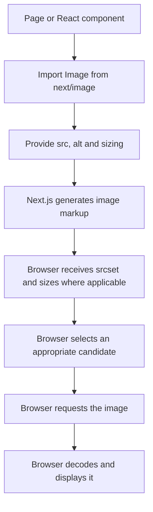

#### Step-by-step explanation
1. You import `Image` from `next/image`.
2. You specify the image source and layout information.
3. Next.js generates image markup and responsive candidates where applicable.
4. The browser evaluates the available candidates.
5. The browser chooses an appropriate URL based on factors such as viewport size, device pixel ratio, and `sizes`.
6. The browser requests the selected image.
7. The image is decoded and displayed.

The browser does not normally download every candidate. It selects an appropriate one from the available responsive image information.

### 2.2 Default Image Optimization Flow

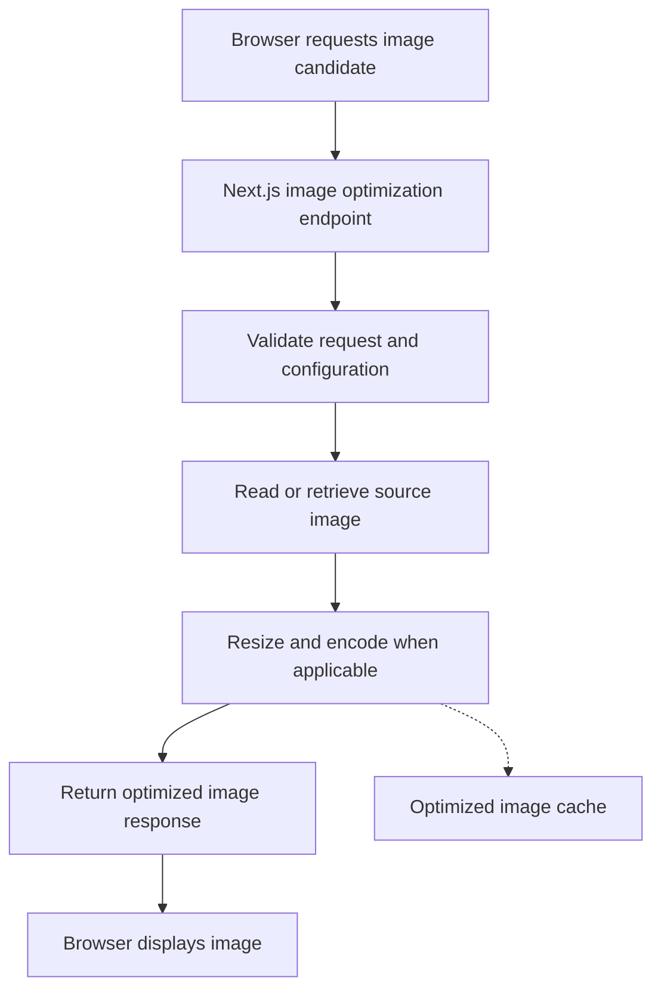

This is a conceptual flow. Cached images may be reused, and custom loaders or unoptimized images may bypass the default optimizer.

### 2.3 Different Image Delivery Paths

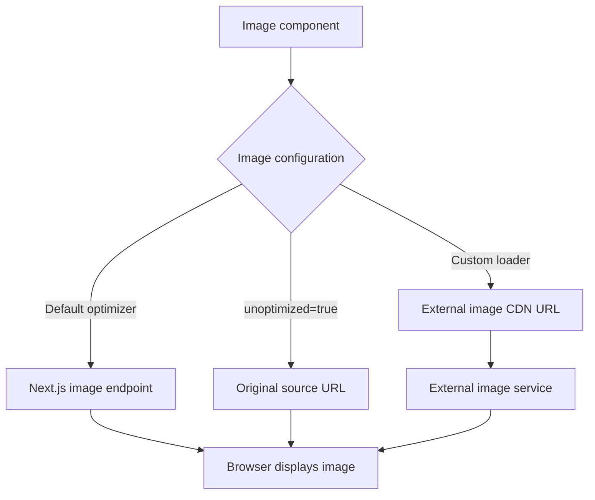

#### Remember
- `next/image` is the React component.
- `srcset` provides responsive image candidates.
- The browser chooses which candidate to request.
- The default optimizer can resize and encode images.
- A custom loader constructs a URL for an external service.
- `unoptimized` bypasses the default image optimization for that image.

---

## 3. Basic Implementation

In a standard Next.js project, you do not need to install a separate package for `next/image`.

```jsx
import Image from 'next/image';

export default function Avatar() {
  return (
    <Image
      src="/avatar.png"
      alt="Profile avatar"
      width={160}
      height={160}
    />
  );
}
```

### Understanding the props
- `src`: Image location.
- `alt`: Text alternative for accessibility.
- `width`: Intrinsic image width.
- `height`: Intrinsic image height.

The `width` and `height` values help establish the image's aspect ratio and prevent layout shifts. They do not necessarily determine the final CSS-rendered dimensions.

For meaningful images, provide descriptive `alt` text. For purely decorative images, use `alt=""`.

---

## 4. Different Ways to Provide Images

### 4.1 Image inside the public directory

**Project structure:**
```text
my-app/
├── app/
│   └── page.jsx
└── public/
    └── images/
        └── mountain.jpg
```

**Implementation:**
```jsx
import Image from 'next/image';

export default function Page() {
  return (
    <Image
      src="/images/mountain.jpg"
      alt="Mountain at sunrise"
      width={1200}
      height={800}
    />
  );
}
```

Files in `public` are referenced from the site root.

- **Correct:** `src="/images/mountain.jpg"`
- **Incorrect:** `src="/public/images/mountain.jpg"`

### 4.2 Static image import

```jsx
import Image from 'next/image';
import mountain from './mountain.jpg';

export default function Page() {
  return (
    <Image
      src={mountain}
      alt="Mountain at sunrise"
    />
  );
}
```

For supported static image imports, Next.js can infer dimensions. It can also provide blur data for supported images where the build pipeline generates it.

### 4.3 Remote image

```jsx
import Image from 'next/image';

export default function Page() {
  return (
    <Image
      src="https://images.example.com/products/shoe.jpg"
      alt="Running shoe"
      width={800}
      height={600}
    />
  );
}
```

When using the default optimizer, configure the permitted remote source using `remotePatterns`.

---

## 5. Remote Images and `remotePatterns`

Next.js restricts remote image URLs for the default optimizer. This helps prevent the image endpoint from fetching arbitrary remote resources.

**Example `next.config.js`:**
```javascript
/** @type {import('next').NextConfig} */
const nextConfig = {
  images: {
    remotePatterns: [
      {
        protocol: 'https',
        hostname: 'images.example.com',
        port: '',
        pathname: '/products/**',
      },
    ],
  },
};

module.exports = nextConfig;
```

Now this image matches the configured pattern:
```jsx
<Image
  src="https://images.example.com/products/shoe.jpg"
  alt="Running shoe"
  width={800}
  height={600}
/>
```

### How `remotePatterns` works

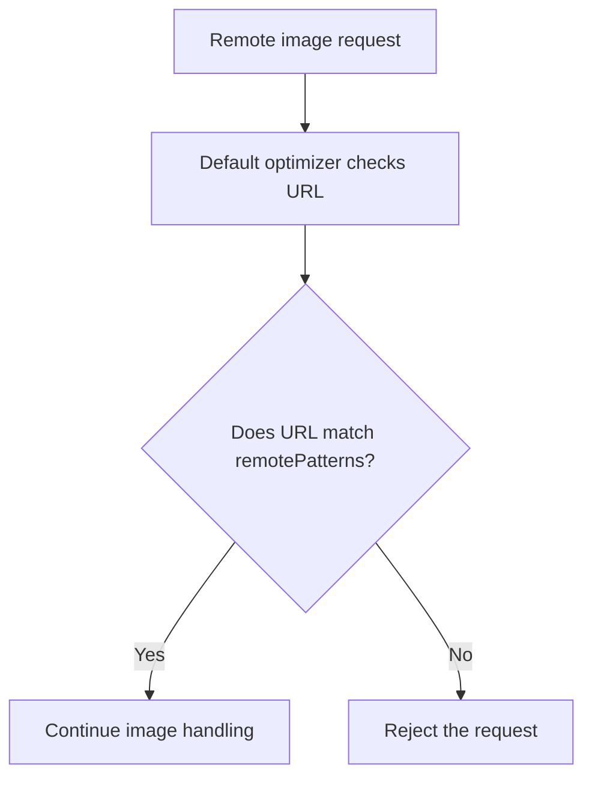

#### Security tip
Configure the narrowest hostname and path pattern possible. Avoid allowing every hostname or path unless you have a specific reason.

### `localPatterns`
`localPatterns` can restrict which local paths the default optimizer may process.

```javascript
const nextConfig = {
  images: {
    localPatterns: [
      {
        pathname: '/images/**',
        search: '',
      },
    ],
  },
};

module.exports = nextConfig;
```

Check the documentation for the Next.js version used by your project before copying configuration options.

---

## 6. Image Sizing: `width`, `height`, and `fill`

Choosing the correct sizing approach is one of the most important parts of using `next/image`.

### 6.1 Using `width` and `height`
Use these when the image has known dimensions or a known aspect ratio.

```jsx
<Image
  src="/images/product.jpg"
  alt="Product on a table"
  width={800}
  height={600}
  style={{
    width: '100%',
    height: 'auto',
  }}
/>
```

The dimensions establish an intrinsic aspect ratio. CSS can still control the rendered size.

### 6.2 Using `fill`
Use `fill` when the image should occupy a parent container.

```jsx
<div className="image-container">
  <Image
    src="/images/cover.jpg"
    alt="Book cover"
    fill
    sizes="(max-width: 768px) 100vw, 400px"
    style={{ objectFit: 'cover' }}
  />
</div>
```

**CSS:**
```css
.image-container {
  position: relative;
  width: 100%;
  height: 300px;
  overflow: hidden;
}
```

With `fill`, the parent needs a meaningful layout area. Usually, make the parent positioned and give it a defined height or aspect ratio.

### 6.3 How `fill` works

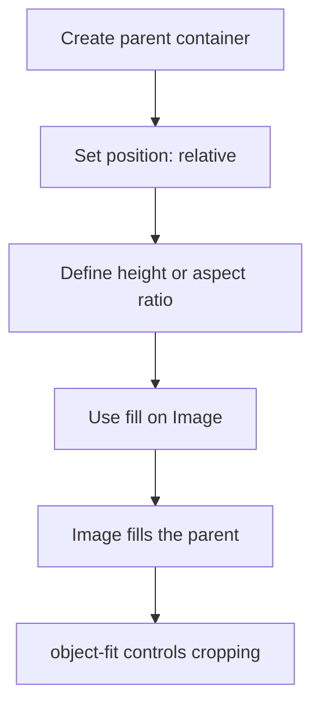

### 6.4 `object-fit`
- `cover`: Fills the box while preserving the image's aspect ratio. Some content may be cropped.
- `contain`: Shows the complete image, potentially leaving empty space.
- `fill`: Stretches the image to fit and may distort its proportions.

For product cards and hero images, `cover` is common.

### 6.5 `object-position`
Controls which region remains visible when cropping occurs.

```jsx
<Image
  src="/images/person.jpg"
  alt="Person standing outdoors"
  fill
  sizes="100vw"
  style={{
    objectFit: 'cover',
    objectPosition: 'center top',
  }}
/>
```

> **Important:** `objectFit` and `objectPosition` are CSS properties, not standalone Next.js Image props.

---

## 7. Responsive Images and `sizes`

### Why do we need `sizes`?
Imagine an image that occupies:
- 100% of the viewport on mobile.
- 50% of the viewport on a tablet.
- 33% of the viewport on a desktop.

The browser needs an estimate of the image's rendered width to choose a suitable image candidate.

**Example:**
```jsx
<Image
  src="/images/landscape.jpg"
  alt="Landscape"
  width={1600}
  height={900}
  sizes="(max-width: 640px) 100vw, (max-width: 1024px) 50vw, 33vw"
  style={{
    width: '100%',
    height: 'auto',
  }}
/>
```

### Understanding the value
```text
(max-width: 640px) 100vw,
(max-width: 1024px) 50vw,
33vw
```

This means:
- At viewport widths up to 640px, the image is expected to render at approximately 100% of the viewport width.
- Up to 1024px, approximately 50% of the viewport width.
- Otherwise, approximately 33% of the viewport width.

These are estimates of the rendered CSS width. Match them to your actual layout.

### Browser candidate-selection flow

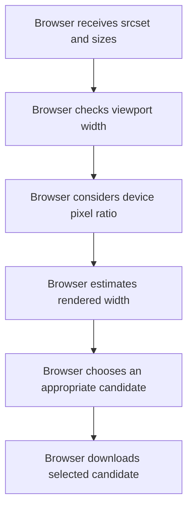

### Common examples

| Layout | Example `sizes` |
| :--- | :--- |
| **Full-width hero** | `100vw` |
| **Full-width mobile, one-third desktop** | `(max-width: 768px) 100vw, 33vw` |
| **Half-width image** | `50vw` |
| **Fixed-width image genuinely around 320px** | `320px` |

> **Rule:** For responsive images, especially when using `fill`, supply a `sizes` value that describes the actual CSS layout. A wrong value can waste bandwidth.

---

## 8. Image Optimization Flow

### 8.1 What the default optimizer can do
Depending on the source, configuration, and deployment, the default optimizer can:
- Resize images to requested widths.
- Encode images in supported output formats.
- Return variants suited to the request.
- Cache optimized variants according to Next.js and deployment rules.

It is not a universal image editor, and optimization does not automatically improve every image in every situation.

### 8.2 Format negotiation

**Example configuration:**
```javascript
const nextConfig = {
  images: {
    formats: ['image/avif', 'image/webp'],
  },
};

module.exports = nextConfig;
```

The optimizer can negotiate a supported output format using the request's `Accept` header. Browser support and deployment conditions affect the final format.
- **AVIF:** Can produce smaller files in many cases, but encoding can take longer.
- **WebP:** Often provides a useful balance of compression and compatibility.
- **Original format:** May be returned in some circumstances.

### 8.3 Caching flow

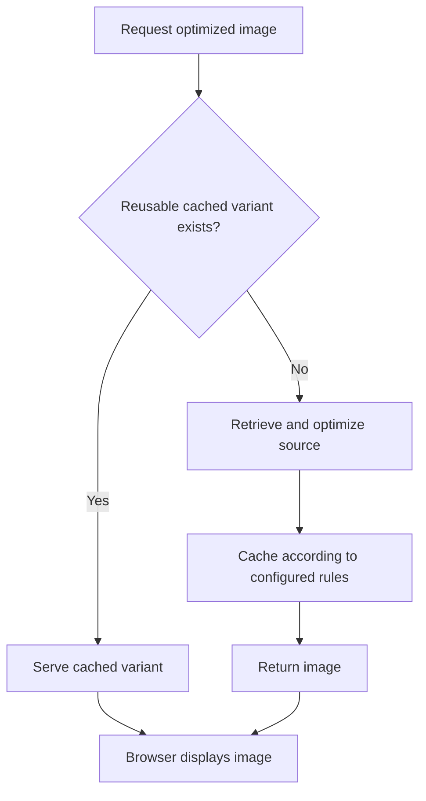

Exact caching behavior depends on source headers, cache lifetime settings, Next.js version, and deployment platform.

### 8.4 `minimumCacheTTL`
`minimumCacheTTL` configures a minimum cache lifetime for images processed by the default optimizer.

It is not a universal instant-purge mechanism. If you replace an image and need the updated version to appear reliably, consider versioned URLs or changing the source URL when the content changes.

---

## 9. Important Image Props

This section summarizes the most useful props. Some are standard HTML image attributes passed through by Next.js. Exact behavior can change between releases.

### 9.1 Source and accessibility

| Prop | Purpose |
| :--- | :--- |
| `src` | Local path, remote URL, or static import |
| `alt` | Text alternative for accessibility |
| `width` | Intrinsic width |
| `height` | Intrinsic height |
| `fill` | Fills the positioned parent |
| `sizes` | Describes expected rendered CSS width |

### 9.2 Loading and priority

| Prop | Purpose |
| :--- | :--- |
| `loading` | Common values include `lazy` and `eager` |
| `preload` | Requests preloading for an image needed early |
| `fetchPriority` | Browser fetch-priority hint: `high`, `low`, or `auto` |
| `decoding` | Decoding hint: `async`, `sync`, or `auto` |

> For current Next.js versions, `priority` has been deprecated in favor of `preload`. Check the documentation for your installed version.

### 9.3 Visual appearance and placeholders

| Prop | Purpose |
| :--- | :--- |
| `placeholder` | Commonly `empty` or `blur` |
| `blurDataURL` | Small image data used as a blur placeholder |
| `style` | Inline CSS |
| `className` | CSS class names |
| `objectFit` | Usually specified through CSS |
| `objectPosition` | Usually specified through CSS |

> **Remember:** `objectFit` and `objectPosition` are typically properties inside `style`, not standalone Image props.

### 9.4 Optimization and URL handling

| Prop | Purpose |
| :--- | :--- |
| `quality` | Requested output quality, subject to configuration/version constraints |
| `unoptimized` | Bypasses the default Next.js optimizer for this image |
| `loader` | Function that constructs an external image URL |
| `overrideSrc` | Overrides the rendered `src` attribute for specialized use cases |

### 9.5 Event callbacks

| Prop | Purpose |
| :--- | :--- |
| `onLoad` | Called after the image loads successfully |
| `onError` | Called when loading fails |

These callbacks require Client Component behavior because they are functions executed in the browser. (`onLoadingComplete` is deprecated; use `onLoad` instead).

### 9.6 Other attributes
Common HTML attributes such as `id`, `title`, `aria-*`, and `data-*` can be used where supported.

---

## 10. Blur Placeholders

A blur placeholder displays a small blurred image while the full image loads.

```jsx
<Image
  src="/images/forest.jpg"
  alt="Forest in the morning"
  width={1200}
  height={800}
  placeholder="blur"
  blurDataURL="data:image/jpeg;base64,VALID_SMALL_IMAGE_DATA"
/>
```

The data URL above is illustrative. Replace it with valid image data if you provide one manually.

For supported static imports, Next.js can generate blur data automatically. For remote or dynamically selected images, provide a valid `blurDataURL` when you need the blur effect.

### Placeholder flow

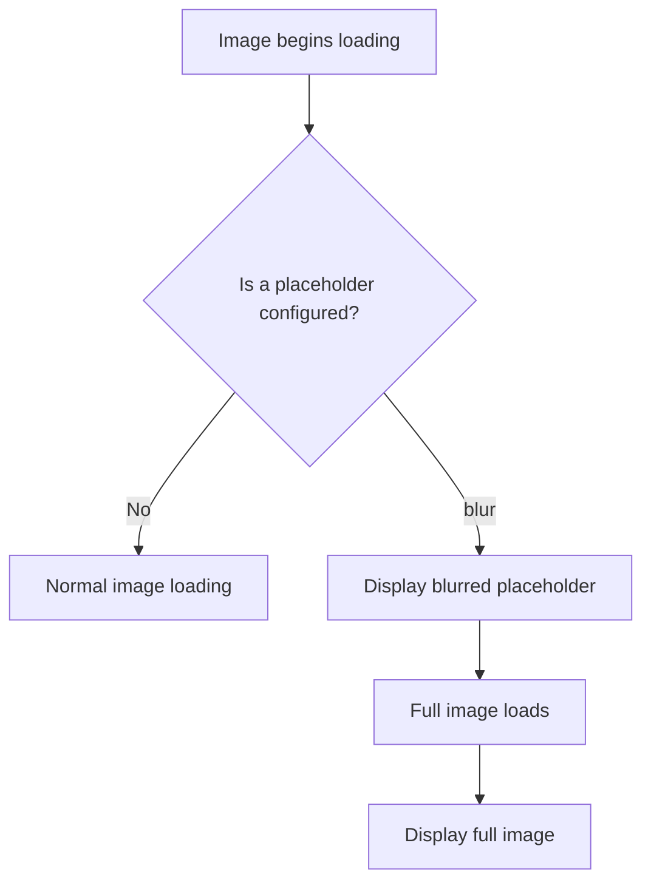

#### Important points
- The placeholder is not the final image.
- Large `blurDataURL` strings can increase page payload.
- Remote images do not automatically have a blur data URL generated at build time.

---

## 11. Loading, Preloading, and LCP

**LCP** means Largest Contentful Paint. It often corresponds to a prominent hero image or another large content element.

### 11.1 Lazy loading
Images that are far below the fold usually should not all be fetched immediately.

```jsx
<Image
  src="/images/review-avatar.jpg"
  alt="Customer avatar"
  width={64}
  height={64}
/>
```

`next/image` uses lazy loading by default when appropriate.

### 11.2 Preloading a likely LCP image

```jsx
<Image
  src="/images/home-hero.jpg"
  alt="People collaborating in an office"
  width={1600}
  height={900}
  sizes="100vw"
  preload
/>
```

Use `preload` selectively for an image that should be fetched early, such as a known critical hero image. Depending on the situation and Next.js version, `loading="eager"` or `fetchPriority="high"` may be more appropriate.

### Decision flow

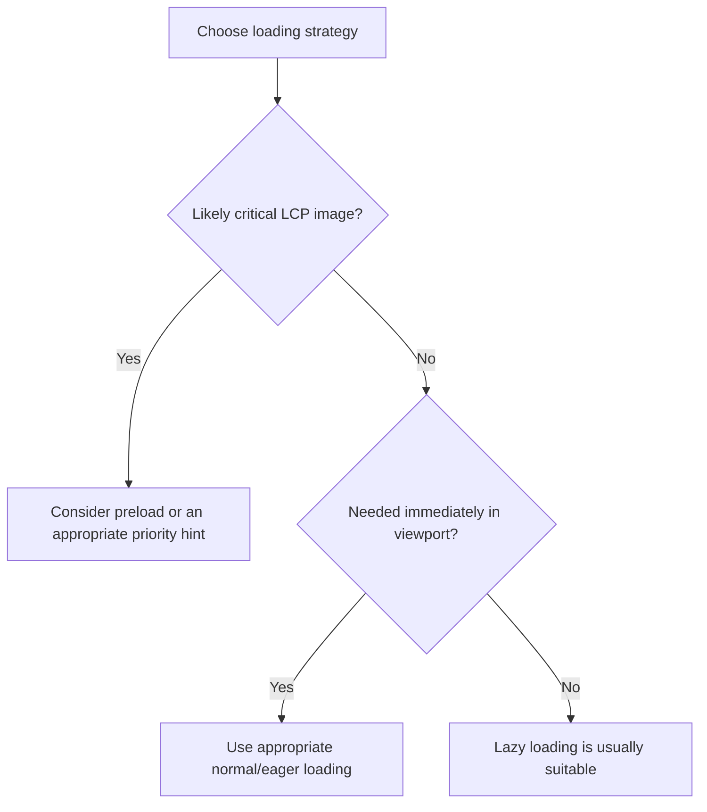

> Do not preload every image. Too many preloads compete for network bandwidth.

---

## 12. Client Components and Callbacks

Functions such as `onLoad` and `onError` run in the browser. In the App Router, place the callback logic in a Client Component.

```jsx
'use client';

import { useState } from 'react';
import Image from 'next/image';

export default function Avatar() {
  const [loaded, setLoaded] = useState(false);
  const [failed, setFailed] = useState(false);

  return (
    <div>
      <Image
        src="/avatar.png"
        alt="User avatar"
        width={128}
        height={128}
        onLoad={() => setLoaded(true)}
        onError={() => setFailed(true)}
      />

      {loaded && <p>Image loaded.</p>}
      {failed && <p>Image could not be loaded.</p>}
    </div>
  );
}
```

### Why `'use client'`?

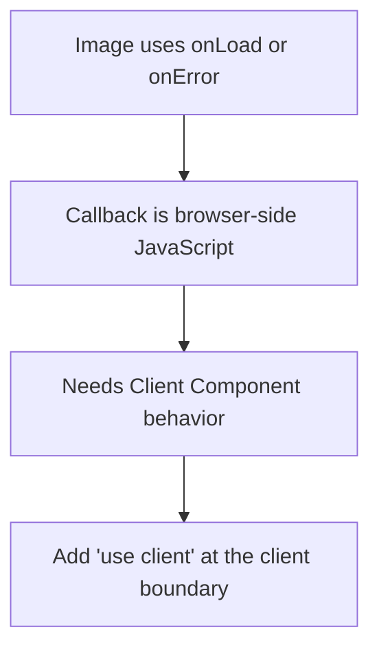

You do not need to convert the entire page to a Client Component just to use one image callback. A small child component can own the interaction.

---

## 13. Custom Loaders

A custom loader constructs the URL used to retrieve an image from an external image service. It does not itself resize or encode the image. The external service must support those URL parameters.

```jsx
import Image from 'next/image';

function imageLoader({ src, width, quality }) {
  const q = quality || 75;

  return `https://cdn.example.com/${src}?w=${width}&q=${q}`;
}

export default function ProductImage() {
  return (
    <Image
      loader={imageLoader}
      src="products/shoe.jpg"
      alt="Running shoe"
      width={800}
      height={600}
      sizes="(max-width: 768px) 100vw, 50vw"
    />
  );
}
```

The URL format is only an example. Adapt it to the actual API of your image provider.

### Global loader with `loaderFile`

**`next.config.js`:**
```javascript
const nextConfig = {
  images: {
    loader: 'custom',
    loaderFile: './app/image-loader.js',
  },
};

module.exports = nextConfig;
```

**Example `app/image-loader.js`:**
```javascript
export default function imageLoader({ src, width, quality }) {
  const q = quality || 75;

  return `https://cdn.example.com/${src}?w=${width}&q=${q}`;
}
```

Use a custom loader when a dedicated image CDN already provides resizing and optimization. Confirm that the CDN supports the requested width and quality parameters.

---

## 14. `getImageProps()`

`getImageProps()` is exported from `next/image`. It returns the underlying image props without requiring you to render the standard `Image` component directly.

```jsx
import { getImageProps } from 'next/image';

export default function Page() {
  const { props } = getImageProps({
    src: '/images/landscape.jpg',
    alt: 'Mountain landscape',
    width: 1200,
    height: 800,
    sizes: '100vw',
  });

  return ;
}
```

It can be useful for specialized rendering patterns, custom markup, and art direction.

> **Important limitation:** `getImageProps()` does not manage the blur-placeholder lifecycle for you. It is not a complete replacement for `<Image>` when you need its managed placeholder transition behavior.

---

## 15. Image Configuration

Configuration goes in `next.config.js` or `next.config.ts`.

**Example:**
```javascript
/** @type {import('next').NextConfig} */
const nextConfig = {
  images: {
    remotePatterns: [
      {
        protocol: 'https',
        hostname: 'images.example.com',
        pathname: '/**',
      },
    ],
    formats: ['image/avif', 'image/webp'],
    deviceSizes: [640, 750, 828, 1080, 1200, 1920],
    imageSizes: [16, 32, 48, 64, 96, 128, 256, 384],
    minimumCacheTTL: 60,
  },
};

module.exports = nextConfig;
```

This is an illustrative configuration, not a universal production setup. Prefer defaults until you have a measured reason to change them.

### Common configuration options

| Option | Purpose |
| :--- | :--- |
| `remotePatterns` | Remote URLs the default optimizer is allowed to handle |
| `localPatterns` | Local URL paths the optimizer is allowed to handle |
| `formats` | Preferred optimized output formats |
| `deviceSizes` | Candidate widths for larger responsive images |
| `imageSizes` | Candidate widths for smaller images |
| `qualities` | Allowed quality values in versions that support this option |
| `minimumCacheTTL` | Minimum cache lifetime for optimized images |
| `loader` / `loaderFile` | Custom image URL generation |
| `unoptimized` | Configuration-level option to bypass optimization |
| `maximumRedirects` | Redirect limit in supported versions |
| `maximumResponseBody` | Remote source response-size limit in supported versions |

### When might you use `unoptimized`?

```jsx
<Image
  src="/logo.svg"
  alt="Company logo"
  width={180}
  height={48}
  unoptimized
/>
```

This may be suitable for SVGs, animated images, or sources you intentionally want to serve without the default optimizer. SVGs are vector assets and often do not benefit from raster-style resizing.

---

## 16. Practical Examples

### 16.1 Product card with responsive image

```jsx
import Image from 'next/image';

export default function ProductCard() {
  return (
    <article className="overflow-hidden rounded-xl border">
      <div className="relative h-64">
        <Image
          src="/products/shoe.jpg"
          alt="Black running shoe"
          fill
          sizes="(max-width: 640px) 100vw, (max-width: 1024px) 50vw, 320px"
          style={{ objectFit: 'cover' }}
        />
      </div>

      <div className="p-4">
        <h2 className="font-semibold">Running Shoe</h2>
        <p>Lightweight everyday trainer.</p>
      </div>
    </article>
  );
}
```

The relative `h-64` wrapper establishes the positioned area for `fill`. The `sizes` value describes the expected image width across breakpoints.

### 16.2 Hero image

```jsx
import Image from 'next/image';

export default function Hero() {
  return (
    <section className="relative min-h-[420px] overflow-hidden">
      <Image
        src="/images/hero.jpg"
        alt="Team working together"
        fill
        sizes="100vw"
        preload
        style={{
          objectFit: 'cover',
          objectPosition: 'center',
        }}
      />

      <div className="relative z-10 p-10 text-white">
        <h1 className="text-4xl font-bold">
          Build something great
        </h1>

        <p>Turn your ideas into products.</p>
      </div>
    </section>
  );
}
```

The overlay content is positioned above the image. Make sure the image has enough contrast for accessible text.

### 16.3 Remote product image

**`next.config.js`:**
```javascript
const nextConfig = {
  images: {
    remotePatterns: [
      {
        protocol: 'https',
        hostname: 'images.example.com',
        pathname: '/catalog/**',
      },
    ],
  },
};

module.exports = nextConfig;
```

**Component:**
```jsx
import Image from 'next/image';

export default function RemoteProduct() {
  return (
    <Image
      src="https://images.example.com/catalog/item-123.jpg"
      alt="Product item"
      width={720}
      height={540}
      sizes="(max-width: 768px) 100vw, 720px"
    />
  );
}
```

> Restart the development server after changing Next.js configuration.

### 16.4 Static import with blur

```jsx
import Image from 'next/image';
import landscape from './landscape.jpg';

export default function Landscape() {
  return (
    <Image
      src={landscape}
      alt="Green landscape"
      placeholder="blur"
    />
  );
}
```

For supported static imports, dimensions and blur data can be supplied by the build system.

---

## 17. Common Mistakes and Debugging

- **Mistake 1: Remote image is rejected**
  - *Symptom:* The optimizer reports that the hostname is not configured.
  - *Fix:* Add a matching, restrictive `remotePatterns` entry and restart the development server.

- **Mistake 2: `fill` image is invisible or has unexpected dimensions**
  - *Likely cause:* The parent has no meaningful height or is not the intended positioned ancestor.
  - *Fix:* Give the parent `position: relative` and a defined height or aspect ratio.

- **Mistake 3: Large images download on mobile**
  - *Likely cause:* Missing or inaccurate `sizes` for a responsive image.
  - *Fix:* Describe the actual rendered width at common breakpoints.

- **Mistake 4: Blur placeholder errors**
  - *Likely cause:* `placeholder="blur"` is used with a remote or dynamic source without a valid `blurDataURL`.
  - *Fix:* Provide a valid small data URL or remove the blur placeholder.

- **Mistake 5: Preloading every image**
  - *Likely cause:* Treating all images as critical.
  - *Fix:* Preload selectively, usually only for an image likely to be the LCP element.

- **Mistake 6: Using `onLoad` in a Server Component**
  - *Likely cause:* A function callback is passed from a Server Component.
  - *Fix:* Move the callback into a small Client Component marked with `'use client'`.

- **Mistake 7: Assuming quality accepts any number**
  - *Likely cause:* Different Next.js versions may restrict allowed quality values.
  - *Fix:* Check the installed version's configuration and allowed quality settings.

- **Mistake 8: Assuming every image uses the default optimizer**
  - *Likely cause:* A custom loader or `unoptimized` has changed the image delivery path.
  - *Fix:* Identify whether the image uses the default optimizer, a custom CDN loader, or direct source delivery.

### Debugging flowchart

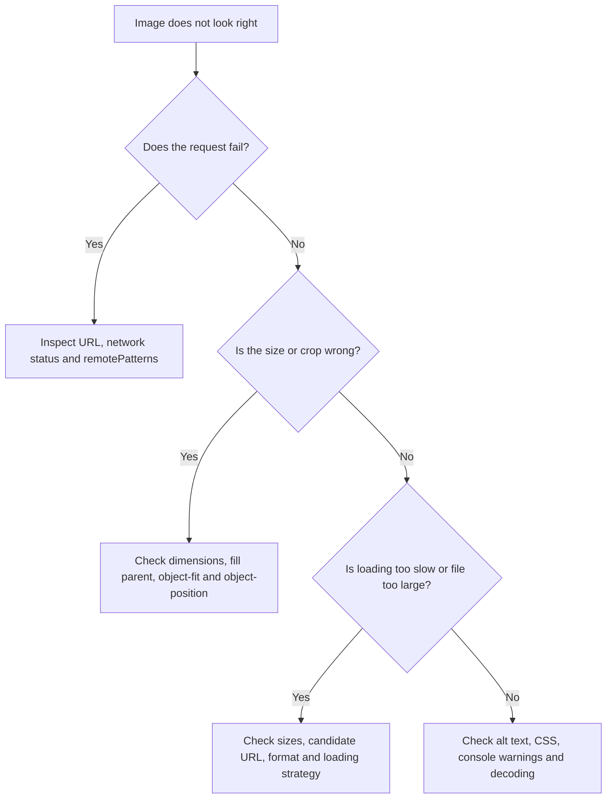

---

## 18. Quick Revision

### Choose the right setup

| Situation | Recommended starting point |
| :--- | :--- |
| **Local image with known dimensions** | `src`, `width`, `height`, `alt` |
| **Static imported image** | Static import and `alt` |
| **Remote image with default optimizer** | `remotePatterns`, `src`, sizing, `alt` |
| **Image fills a card or hero** | `fill`, positioned parent, defined dimensions, `sizes` |
| **Responsive image** | Accurate `sizes` |
| **Likely LCP hero image** | Consider `preload` or another suitable priority hint |
| **Remote image needs blur** | Provide valid `blurDataURL` |
| **Image CDN already optimizes images** | Consider a custom loader |
| **SVG or animated source served directly** | Consider `unoptimized` |

### Mental model
1. `src` identifies the source.
2. `width` / `height` or `fill` describes the layout relationship.
3. `sizes` describes the expected rendered width for responsive selection.
4. The browser chooses a candidate from responsive attributes.
5. The delivery path determines whether the default optimizer, custom loader, or original source is used.
6. Loading strategy controls when the browser should fetch the image.
7. Caching and image format affect repeat performance and transfer size.

---

## 19. Practice Questions

Try answering these without looking back.

1. Your image must fill a 300px-tall card. Which approach should you use, and what must the parent provide?
2. What does `sizes` tell the browser?
3. What must you configure for a remote image using the default Next.js optimizer?
4. Why should you avoid preloading every image?
5. Why might `onLoad` require a Client Component?
6. What is the difference between `fill` and `width`/`height`?
7. What changes when you set `unoptimized`?
8. Does `getImageProps()` manage the blur-placeholder transition like `<Image>`?

<details>
<summary><strong>Click to view Answers</strong></summary>

1. Use `fill`; give the parent a positioned layout context (e.g., `position: relative`) and a defined height or aspect ratio.
2. It describes the expected rendered CSS width so the browser can choose a suitable responsive candidate from `srcset`.
3. Add a matching `remotePatterns` entry in `next.config.js`.
4. Too many preloads compete for network bandwidth and can delay more critical resources.
5. `onLoad` passes a browser-side function callback, which cannot be serialized across the server/client boundary in Server Components.
6. `width`/`height` provide intrinsic dimensions and establish aspect ratio; `fill` forces the image to stretch/fit its positioned parent element.
7. The default Next.js image optimization endpoint is bypassed, and the original image URL is served directly.
8. No. `getImageProps()` does not manage the blur-placeholder lifecycle.
</details>

---

## Official References
- **Image component:** [https://nextjs.org/docs/app/api-reference/components/image](https://nextjs.org/docs/app/api-reference/components/image)
- **Image configuration:** [https://nextjs.org/docs/app/api-reference/components/image#configuration-options](https://nextjs.org/docs/app/api-reference/components/image#configuration-options)
- **Public folder:** [https://nextjs.org/docs/app/api-reference/file-conventions/public-folder](https://nextjs.org/docs/app/api-reference/file-conventions/public-folder)

> **Version reminder:** Next.js APIs and configuration can change between releases. Verify version-specific options against the documentation for the version installed in your project.